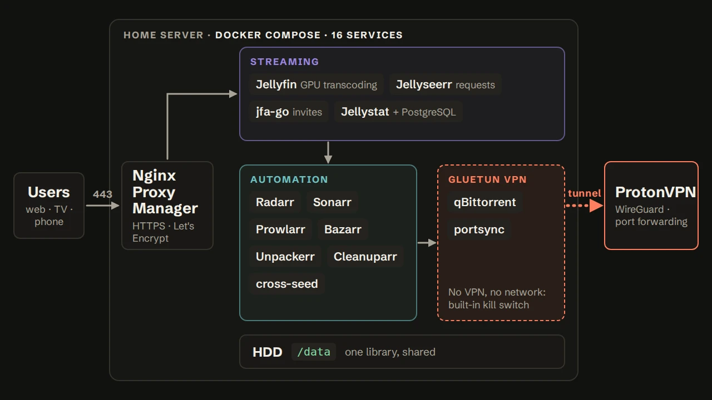

# Home server

A self-hosted media platform running on a single home server: 16 services in one Docker Compose file, with streaming, library automation, a reverse proxy with HTTPS and a download client that can only reach the internet through a VPN.



## Services

| Group | Service | Role |
|---|---|---|
| Entry point | [Nginx Proxy Manager](https://nginxproxymanager.com/) | Reverse proxy, HTTPS certificates from Let's Encrypt |
| Streaming | [Jellyfin](https://jellyfin.org/) | Media server, hardware transcoding on the GPU |
| | [Jellyseerr](https://github.com/fallenbagel/jellyseerr) | Request portal for users |
| | [jfa-go](https://github.com/hrfee/jfa-go) | Invite-based account creation for Jellyfin |
| | [Jellystat](https://github.com/CyferShepard/Jellystat) + PostgreSQL | Usage statistics |
| Automation | [Radarr](https://radarr.video/), [Sonarr](https://sonarr.tv/) | Movie and series library management |
| | [Prowlarr](https://prowlarr.com/) | Indexer management for Radarr and Sonarr |
| | [Bazarr](https://www.bazarr.media/) | Subtitles |
| | [Unpackerr](https://github.com/Unpackerr/unpackerr) | Extracts archives before import |
| | [Cleanuparr](https://github.com/Cleanuparr/Cleanuparr) | Removes stalled or unwanted downloads |
| | [cross-seed](https://www.cross-seed.org/) | Reuses existing files across trackers |
| VPN | [Gluetun](https://github.com/qdm12/gluetun) | WireGuard client for ProtonVPN, with port forwarding |
| | [qBittorrent](https://www.qbittorrent.org/) | Download client, confined to Gluetun's network |
| | portsync | Small script that keeps qBittorrent's listening port in sync with the VPN |

## Design

### VPN confinement (kill switch)

qBittorrent and portsync use `network_mode: service:gluetun`: they have no network interface of their own and share Gluetun's. All their traffic goes through the WireGuard tunnel, and if the tunnel goes down, they lose all connectivity instead of falling back to the home connection. Their web UI is published through Gluetun's ports (`18080`).

Both wait for `gluetun` to be **healthy** (`depends_on: condition: service_healthy`, with `restart: true` so qBittorrent is restarted when Gluetun is).

### Port forwarding

ProtonVPN assigns a forwarded port that can change on every reconnection, and qBittorrent needs to listen on it to be reachable. Two mechanisms keep them aligned:

1. **On connection:** Gluetun runs `VPN_PORT_FORWARDING_UP_COMMAND`, which pushes the new port to qBittorrent's Web API.
2. **Continuously:** `portsync` (an Alpine container with `curl` and `jq`) compares Gluetun's forwarded port with qBittorrent's listening port every 60 seconds and fixes any difference, for example after qBittorrent restarts on its own.

`PORT_FORWARD_ONLY=on` restricts Gluetun to servers that support port forwarding.

### Storage

Every service that touches media mounts the same `/mnt/hdd1/data` as `/data`. Downloads and the library are on the same filesystem, so imports use hardlinks or instant moves instead of copies: no duplicated space and no slow copy step.

### Hardware transcoding

Jellyfin gets the GPU through `/dev/dri` and the host's `video` and `render` groups, so transcoding for phones or slow connections runs on the GPU instead of the CPU.

### Secrets and configuration

- No secret is written in `docker-compose.yml`: they come from a `.env` file that is not committed (see [`.env.example`](.env.example)).
- Each service's state lives in its own folder next to the compose file (bind mounts), so the whole server can be backed up or moved by copying one directory. Jellystat's database uses a named volume and a healthcheck (`pg_isready`) so Jellystat only starts once PostgreSQL accepts connections.
- All LinuxServer images run as `PUID=1000` / `PGID=1000`, so files on the disk belong to a normal user instead of root.

## Running it

Requirements: Linux with Docker and Docker Compose, a ProtonVPN plan with port forwarding, and for hardware transcoding a GPU exposed as `/dev/dri`.

```bash
cp .env.example .env     # then fill in the values
docker compose up -d gluetun
docker compose up -d
```

Then:

1. In qBittorrent (`http://<server>:18080`), enable **Bypass authentication for clients on localhost**: the port-forwarding command and portsync call its API from inside Gluetun's network without logging in.
2. Copy the API keys of Radarr and Sonarr (*Settings → General*) into `.env`, then restart Unpackerr: `docker compose up -d unpackerr`.
3. In Nginx Proxy Manager (`http://<server>:81`), add a proxy host for each service you want to expose, with a Let's Encrypt certificate.

Check that qBittorrent goes through the VPN: the two commands should print different IP addresses.

```bash
curl -s https://ifconfig.me                                    # home IP
docker exec gluetun wget -qO- https://ifconfig.me              # VPN IP
```

## Security notes

- Only ports **80** and **443** should be forwarded on the router, to Nginx Proxy Manager. The other ports (including `81`, NPM's admin page) are for the local network only.
- Jellyfin accounts are created through jfa-go invites, not open sign-up.
